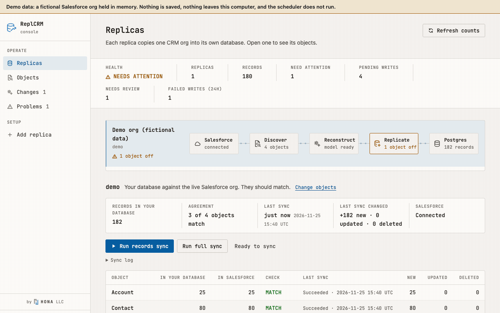

# ReplCRM

**Discover. Reconstruct. Replicate.**



ReplCRM copies a Salesforce org into PostgreSQL and keeps the copy current. It reads objects, fields and relationships from Salesforce metadata, so custom objects need no hand-written mapping. You query the replica with plain SQL, and you can send reviewed edits back to Salesforce.

> **Status:** early open-source project, version 0.4.0. Salesforce is the only implemented source and PostgreSQL the only production store. Live replication has been exercised against a Salesforce Developer Edition org, not certified on production orgs. See the [changelog](CHANGELOG.md).

## What it does today

- **Replicates Salesforce into PostgreSQL.** Metadata discovery, incremental record sync, relationship repair, recycle-bin deletions and purge reconcile. Each selected object is also published as a readable view such as `replica.opportunity`. See [Live replica](docs/live-replica.md).
- **Signs in without a Connected App.** OAuth through a Salesforce External Client App with PKCE and no client secret. Password login remains available. See [Salesforce sign-in](#salesforce-sign-in).
- **Stays current on a schedule.** `npm start -- run` runs inbound sync, metadata refresh and write-back at intervals you set, within a daily Salesforce API budget.
- **Ships a local console.** A loopback-only web console with guided setup and per-object count reconciliation: the count in your database against the count in Salesforce, shown as `MATCH` or `Off by N`. See [Console](#console).

## Write-back and Change Data Capture

**Write-back.** Salesforce remains the system of record. Edits submitted from the CLI, through SQL (including inserts and updates on the readable views), or by apps and agents through the `submitChange` API are stored as change requests. Each request is checked against the field's create or update permission. An update is sent only if Salesforce still holds the value the editor started from; otherwise it stops as a conflict for an operator to resolve. Write-back is off for every object until you enable it, and deletes are refused. The console manages per-object policy and the change queue. See [Write-back](docs/write-back.md).

**Change Data Capture.** For objects that need updates within seconds, select them under Salesforce Setup → Change Data Capture and opt in with `npm start -- schedule set --events Opportunity`. ReplCRM subscribes through the Salesforce Streaming API and runs a small incremental sync for each burst of changes. Scheduled polling keeps running as the safety net, and a gap in the event stream triggers a catch-up poll. See [Live updates per object](docs/live-replica.md#live-updates-per-object).

## Why ReplCRM

CRM schemas change. ReplCRM discovers entities, attributes and relationships from metadata rather than requiring a fixed model per customer. New fields arrive as new columns without code changes, and the flat tables update in place, so indexes, grants and views you add survive later syncs. Source-specific representations are normalized before entering core, and storage implementations sit behind a ReplCRM-owned semantic contract.

The goal is an independently usable replica, with qualified record identity, preserved collections and references, opaque source checkpoints and convergent replay.

## Architecture

```text
CRM Source
    │
    ▼
SourceAdapter
    │ canonical metadata, records, values and checkpoints
    ▼
ReplCRM Core
    │
    ▼
ReplicaStore
    ├── PostgresReplicaStore → Prisma → PostgreSQL
    └── InMemoryReplicaStore → database-free reference/testing
```

Core imports no concrete source/store implementation, Prisma or database driver. Source adapters interpret native CRM semantics. Replica stores choose their own drivers, physical schemas, indexes, batching and projection mechanisms while preserving the same logical guarantees. See [architecture principles](docs/architecture-principles.md) and the [ReplicaStore contract](docs/replica-store.md).

## Current capabilities

| Component | Status |
| --- | --- |
| Salesforce SourceAdapter | Implemented; the only implemented CRM source |
| Canonical metadata/value model | Implemented |
| ReplicaStore v1 | V1_READY architectural persistence contract |
| PostgreSQL ReplicaStore | Implemented; only production persistence implementation |
| InMemoryReplicaStore | Implemented, ephemeral reference/testing store |
| Metadata discovery, incremental records and relationship repair | Implemented |
| Opaque checkpoints and ordered at-least-once replay | Implemented; one writer per deployment |
| Projection readiness and consumer discovery | Implemented |
| Readable `replica.*` views and in-place projection refresh | Implemented |
| Write-back of updates and creates to Salesforce | Implemented; off by default per object; deletes refused |
| Scheduled sync and Change Data Capture | Implemented; CDC is opt-in per object and polling continues |
| Local console with guided setup | Implemented; loopback only |
| Snowflake ReplicaStore | Planned, not implemented |
| SQL Server / Azure SQL ReplicaStore | Planned, not implemented |
| Oracle ReplicaStore | Planned, not implemented |

**ReplicaStore v1 is a contract version, not a ReplCRM v1 release.** Existing tests are fixture/disposable-database evidence. Populated operator-database upgrade, live Salesforce replication and production image validation remain operational gates. No exactly-once delivery guarantee is made.

ReplCRM replicates CRM metadata and data, not a complete Salesforce org configuration such as Apex, Flow, permission sets or page layouts.

## Try the demo

See the console on a fictional Salesforce org in about 30 seconds. You need Node.js 22 and npm, and nothing else: no Salesforce account, no database and no credentials.

```sh
git clone https://github.com/jej2k5/replcrm.git
cd replcrm
npm ci
npm run demo
```

The demo opens [http://127.0.0.1:4790](http://127.0.0.1:4790) (use `npm run demo -- --port 4999` to change it). It replicates about 180 fictional records into an in-memory replica, with one object deliberately out of step so the count check has something to show. **Run records sync** and **Run full sync** work against the fictional org, and the **Changes** page holds write-back requests you can process into applied, conflict and rejected outcomes. Every page is labeled as demo data. The demo ignores `DATABASE_URL`, Salesforce settings and your ReplCRM configuration directory, listens on loopback only, and deletes its temporary files when you press Ctrl+C. Adding a replica and Salesforce sign-in are turned off.

## Installation and a first replication

Use Node.js 22 and npm, PostgreSQL, and a Salesforce API-enabled integration account for the current CLI. Node 22 is the supported baseline in `package.json`, `.nvmrc`, CI and every Dockerfile stage. The Docker image build is not yet verified in CI, and no image has been published. The memory tests require no CRM account or external database.

```sh
git clone https://github.com/jej2k5/replcrm.git
cd replcrm
npm ci
npm run prisma:generate
cp .env.example .env
npm run build
```

Configure local values in `.env`. Provision the target database and apply the checked-in schema using the [operator runbook](docs/migration-runbook.md). Existing installations must review the identity migration and projection-registry upgrade requirements before running a newer version. Do not run setup/migrations against an operator database casually.

After building, export `DATABASE_URL` and run `npm start -- deployment init --id my-deployment --name "My Deployment"`. You can run this before setting Salesforce credentials. Set `DEPLOYMENT_ID` to the same ID before replication. Repeating the init command preserves the existing deployment.

### Salesforce sign-in

1. Run `npm run --silent auth -- callback-url`. Copy the exact URL it prints into your Salesforce **External Client App** as its OAuth callback URL. The default is `http://localhost:47123/oauth/callback`. Set `SF_OAUTH_CALLBACK_PORT` before running the command if you need a different port.
2. Enable OAuth scopes `api` and `refresh_token/offline_access`. Require PKCE and turn off both secret requirements (web server flow and refresh token flow). Leave `SF_CLIENT_SECRET` unset. Salesforce restricts creation of new Connected Apps. This setup does not use a Connected App.
3. Export the app's consumer key as `SF_CLIENT_ID` and set `DEPLOYMENT_ID` to the deployment you want to sign in. Run `npm run --silent auth -- login` and complete sign-in in the browser. For a sandbox or My Domain, set `SF_LOGIN_URL` or pass `--login-url <url>`.
4. Run `npm run --silent auth -- status` to see the resolved mode and saved sign-in, then `npm run --silent auth -- refresh` to verify that Salesforce accepts the refresh grant. Both support `--json` and omit token values.

Set `SF_AUTH_MODE=password` and export `SF_USERNAME`, `SF_PASSWORD`, and `SF_SECURITY_TOKEN` to use password login. The default `auto` uses the stored OAuth sign-in when present and password credentials otherwise. Use `SF_AUTH_MODE=oauth` to require a stored sign-in. If Salesforce revokes the refresh grant, run `auth login` again. Orgs that limit idle refresh tokens (often to 30 days) expire a sign-in that goes unused that long; sign in again with `auth login` or **Sign in again** in the console's setup.

Use `npm run --silent auth -- logout` to clear the local sign-in. Add `--revoke` to also ask Salesforce to revoke the refresh token. The auth commands run without `DATABASE_URL`.

### Verify and replicate

Run `npm start -- deployment verify [--rebind] [--json]` with `DATABASE_URL`, `DEPLOYMENT_ID` and Salesforce authentication configured. It prints the live Salesforce identity and saves the org ID, user ID, username, instance host and verification time in `~/.config/replcrm/bindings/<DEPLOYMENT_ID>.json`. Set `REPLCRM_CONFIG_DIR` to override the config directory. The binding is per machine. Repeat verification to refresh it, or use `--rebind` to deliberately switch orgs or users.

To reconcile records purged before an incremental sync, preview with `npm run replicate:reconcile -- --entities Account,Task`. Preview requires explicit object names. Pass `--entities a,b` when the saved selection is `*`. Review the saved candidates. Run `npm run replicate:reconcile -- --apply` within 60 minutes with the verified org and user. Apply uses the reviewed plan and marks candidates that are still absent. [Migration runbook](docs/migration-runbook.md#reconcile)

With setup complete:

```sh
node --env-file=.env dist/cli.js
# Or, with configuration already exported into the shell:
npm run replicate
```

Each run discovers metadata, synchronizes users/records, repairs qualified references, publishes successful checkpoints and optionally refreshes projections. Repeat it for incremental synchronization. Serialize runs per deployment. The CLI currently composes Salesforce with PostgreSQL; it does not offer a working store-selection switch for planned backends.

Use `npm run replicate:metadata` to sync entity metadata, `npm run replicate:users` to sync users, `npm run replicate:records` to sync records and repair references, and `npm run replicate:projections` to refresh wide tables independently. Run metadata for the selected entities before running standalone records or projections. Both records and full runs keep wide tables current when enabled. See [Live replica](docs/live-replica.md) for readable views, refreshes, and rebuilds. Use `npm start -- run` to run scheduled inbound sync, metadata refresh, and write-back for a deployment. Manage intervals with `npm start -- schedule` or the console. For selected objects that need faster updates, enable Salesforce Change Data Capture in Setup and opt in with `npm start -- schedule set --events Opportunity,Contact`. Scheduled polling continues. Use `npm start -- objects columns Opportunity` to find the published field aliases. After building, `npm start -- help` lists the CLI commands. The legacy `migrate:metadata` and `migrate:records` scripts run their corresponding stages and print deprecation warnings to stderr. No npm package is published by this setup. `private: true` remains intentional.

Run one sync per deployment at a time. “Another sync is running” identifies the holder by command, PID, host, and start time. Ctrl-C releases the lock. A hard kill or crash can leave it behind. Confirm the holder has stopped, checking its host if different, then delete the named lock file and retry. This protection covers processes sharing the same configuration directory. A container with a separate config directory has its own lock. [Migration runbook](docs/migration-runbook.md#sync-lock)

After replication, run `node dist/cli.js counts` to compare active store and Salesforce counts per entity. Add `--json` for machine-readable output or `--store-only` to report only store counts without Salesforce credentials. Review any DIFF using the [checkpoint run](docs/migration-runbook.md#checkpoint-run).

Records sync picks up deletions still in the Salesforce Recycle Bin and reactivates undeleted records. Active counts include archived activities. The first successful records run after upgrading backfills archived Task and Event rows for existing checkpoints.


## Console

Run `npm run console` and open [http://127.0.0.1:4780](http://127.0.0.1:4780). Use
`npm run console -- --port 4999` (or `REPLCRM_CONSOLE_PORT`) to change the port. The console
listens on loopback only and authorizes actions with a per-process token.

The console needs no configuration to start. With no reachable database, no schema or no
replica yet, it opens on **Add a replica**, the guided setup.

### Replicas

Every deployment in the database is a replica: one CRM org copying into its own database.
Each is drawn as a pipeline (Salesforce, Discover, Reconstruct, Replicate, Postgres); during a
sync the active stage lights up and its connectors carry moving data. The health strip counts
replicas, records and replicas that need attention. Open a replica to see, per object, the
count in your database against the count in Salesforce, `MATCH` or `Off by N`, and the last
sync's new, updated and deleted totals. **Run records sync** and **Run full sync** sync the
replica's saved selection. **Change objects** reopens object selection.

The console and CLI share one run lock per deployment when they use the same configuration
directory. A sync waits for an active local write-back batch to finish. Other competing sync
starts are refused with the lock holder named. Running entries
without a lock appear as interrupted syncs. Each replica uses its own stored Salesforce
sign-in; password variables apply only to `DEPLOYMENT_ID`. The page refreshes every 15
seconds; **Refresh counts** asks for a fresh snapshot. Light and dark themes follow the
system setting, with a toggle in the sidebar.

Press Ctrl+C to stop the console. It gives active syncs up to ten seconds to finish, then
marks them failed if still running and frees their locks before closing.

### Setup

**Add replica** walks through seven steps, each checked against reality before the next opens:
connect a PostgreSQL database, create or update ReplCRM's tables, name the replica, connect a
Salesforce External Client App, sign in, choose objects, and run the first sync until every
object matches. You can leave at any point and pick up where you left off.

- The database URL is tested before it is saved, stored owner-only in the configuration
  directory, and shown without its password. `DATABASE_URL` in the environment takes precedence.
- Setup only runs `prisma migrate deploy`. It refuses databases holding tables ReplCRM didn't
  create, and asks you to confirm a backup before updating a database that already holds data.
- The consumer key and login URL are saved per replica. Sign-in uses the same browser flow as
  `auth login`; ReplCRM stores the sign-in, never the password.

The same steps run in the terminal: `npm start -- setup [--deployment <id>]` asks each
question in turn (the database URL is not echoed), and `npm start -- setup status [--json]`
reports which steps are done.

## Configuration

| Domain | Current configuration |
| --- | --- |
| Local deployment binding | `REPLCRM_CONFIG_DIR` (optional) |
| Core orchestration | `DEPLOYMENT_ID`, `SYNC_BATCH_SIZE`, `SYNC_ENTITIES`, `SYNC_ENTITY_DENY`, `BUILD_WIDE_VIEWS` |
| Salesforce adapter | `SF_AUTH_MODE` defaults to `auto`. OAuth uses a stored sign-in and `SF_CLIENT_ID`. The browser callback port is set by `SF_OAUTH_CALLBACK_PORT` (default 47123). Password mode uses `SF_LOGIN_URL`, `SF_USERNAME`, `SF_PASSWORD`, and `SF_SECURITY_TOKEN`. |
| PostgreSQL store | `DATABASE_URL` |

Choose objects per invocation with `--entities a,b` on metadata, records, projections, full, counts, and reconcile preview. Selection precedence is the flag, the deployment's saved selection, `SYNC_ENTITIES`, then the built-in default of Account, Contact, Lead, Opportunity, and Case.

After building, use `npm start -- objects available [--json]` to see the Salesforce objects discovery would allow, and `npm start -- objects list [--json]` to see your selection and its origin. Use `npm start -- objects set Account,Contact,Task,Event,Invoice__c` to save a selection. Use `objects add`, `objects remove`, or `objects clear` through the same CLI to edit or clear it. A single quoted `'*'` requests discovery, and `SYNC_ENTITY_DENY` still applies. [Configuration](docs/configuration.md#salesforce-object-selection)

`BUILD_WIDE_VIEWS=false` skips automatic projection refresh in records and full runs. CLI npm scripts use exported environment variables. The compiled example above explicitly loads `.env`. Prisma commands can load `.env` themselves. Never commit local credentials or customer records.

Consumers discover the last ready projection with `ReplicaStore.resolveProjection`, or the existing PostgreSQL registry. Do not reconstruct physical table/column names from canonical keys.

## Development and testing

```sh
npm ci
npm run prisma:generate
npm test
```

`npm test` and `npm run test:offline` typecheck the project, compile it into a temporary directory and run all top-level `tests/*.test.ts` files with Node’s test runner. The runner cleans up its temporary build. Use `npm run build` to produce the `dist/` used by `npm start`. Use `npm run smoke-test` for the credential-free public smoke checks.

Running `npx prisma validate` separately requires a syntactically valid disposable `DATABASE_URL`. CI supplies a non-secret placeholder. The offline suite uses fake sources and embedded disposable databases. The same ReplicaStore contract runs against embedded PostgreSQL and memory, including persisted-state reopen and failure-injection cases. An import guard also checks that a fake source can replicate through compiled core and memory without loading database modules.

See [CONTRIBUTING.md](CONTRIBUTING.md) for DCO sign-off, testing and extension proposals.

## Project status and community

This is an independently maintained early project. See the [roadmap](ROADMAP.md), [changelog](CHANGELOG.md), [governance](GOVERNANCE.md), [code of conduct](CODE_OF_CONDUCT.md) and [security policy](SECURITY.md). Report vulnerabilities privately through GitHub's private vulnerability reporting, as described in the security policy. Do not post vulnerabilities or sensitive logs in public issues. The [release readiness record](docs/oss-clean-release-readiness.md) lists what was reviewed before publication.

## License and names

Licensed under the **Apache License, Version 2.0**. See [LICENSE](LICENSE), [NOTICE](NOTICE) and the [dependency license audit](docs/dependency-license-audit.md). Third-party components retain their own licenses and notices. The [publication manifest](docs/oss-publication-manifest.md) records the provenance and licensing decisions for this distribution.

ReplCRM is an independent project, not an Apache Software Foundation project or affiliate. Technology names identify integrations or plans; they do not imply sponsorship or endorsement by their owners. No third-party logo is used in this README.
